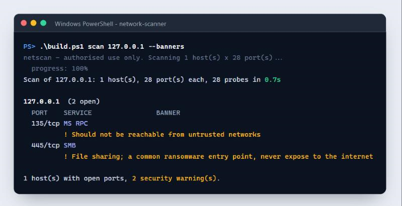

# Network Scanner (Java)

A multithreaded **TCP port scanner** written in plain Java 17 with no libraries. It discovers which
hosts on a network are up, which ports are open and what's running on them, and **flags services
that are risky to expose** (Telnet, SMB, RDP, open databases…). Results can be saved as JSON or CSV.


> **Ethical use:** only scan networks you own or have written permission to test. Unauthorised
> scanning can break acceptable-use policies and laws (in South Africa, the Cybercrimes Act 19 of 2020).



## Example

Illustrative output for a small home or lab network:

```
> .\build.ps1 scan 192.168.1.0/24 --banners --json results.json
netscan - authorised use only. Scanning 254 host(s) x 28 port(s)...
Scan of 192.168.1.0/24: 254 host(s), 28 port(s) each, 7112 probes in 4.2s

192.168.1.1  (3 open)
  PORT    SERVICE                BANNER
  53/tcp  DNS
  80/tcp  HTTP                   lighttpd/1.4.59
  443/tcp HTTPS

192.168.1.20  (3 open)
  PORT    SERVICE                BANNER
  22/tcp  SSH                    SSH-2.0-OpenSSH_9.6p1 Ubuntu-3ubuntu13
  23/tcp  Telnet
          ! Unencrypted remote login; disable and use SSH
  3306/tcp MySQL
          ! Database should only be reachable from app servers

2 host(s) with open ports, 2 security warning(s).
Saved results.json
```

## Features

| | |
|---|---|
| **Targets** | single IP, CIDR block (`10.0.0.0/24`), last-octet range (`192.168.1.1-50`) or host name |
| **Ports** | `top` (28 commonly exposed services, default), lists `22,80,443` and ranges `1-1024` |
| **Speed** | thread pool of concurrent connects with a per-port timeout: 254 hosts × 28 ports in seconds |
| **Banner grabbing** | reads greetings (SSH/FTP/SMTP versions) and sends a harmless `HEAD` to HTTP ports to get the `Server` header |
| **Risk notes** | explains *why* a service is dangerous to expose and what to do instead |
| **Reports** | console table, JSON (`--json`) and CSV (`--csv`) |

## How it works

- **TCP connect scan:** a port is *open* if the full three-way handshake succeeds within the timeout.
  Closed ports refuse the connection; filtered ports (firewall drops) time out. No admin rights or raw
  sockets needed, unlike SYN scanning.
- **Host discovery** is by open ports. ICMP ping often gets blocked by firewalls, and Java can't send
  raw ICMP without admin rights.
- Network and broadcast addresses are skipped for /30 and larger blocks.

## Safety and robustness

- Scan size limits: at most a /22 (1,024 addresses) and 1,024 ports per run, 256 threads, 50 ms–10 s timeout
- **Banners are untrusted input:** stripped to printable ASCII (no terminal escape codes), one line, 80 chars
- JSON output escapes all strings; CSV output quotes fields and neutralises values starting with
  `= + - @` so a malicious banner can't run a formula when the CSV is opened in Excel
- Bad input gives a clear message and exit code 2 instead of a stack trace

## Build and test

Needs JDK 17 or newer.

```powershell
.\build.ps1                                   # compile + run the tests
.\build.ps1 scan 127.0.0.1 -p 1-1000          # scan your own machine
```

```bash
./build.sh
./build.sh scan 192.168.1.0/24 --banners --csv results.csv
```

**17 tests** cover target parsing (CIDR, /31 and /32, octet boundaries, ranges, limits), port lists,
service notes, banner sanitising, JSON/CSV escaping, the CLI's error handling, and a **live scan**
against throw-away local servers (one sends an SSH-style banner, one stays silent, one port is
closed). GitHub Actions runs them on Linux and Windows.

## Code layout

| File | Role |
|---|---|
| `Targets.java` | parse and expand targets to IPv4 addresses |
| `Ports.java` | parse port lists and the default top ports |
| `Services.java` | service names and security notes |
| `PortScanner.java` | concurrent connect scan and banner grabbing |
| `Report.java` | text, JSON and CSV output |
| `NetScanApp.java` | command-line interface |
| `NetScanTest.java` | tests (no JUnit needed) |
